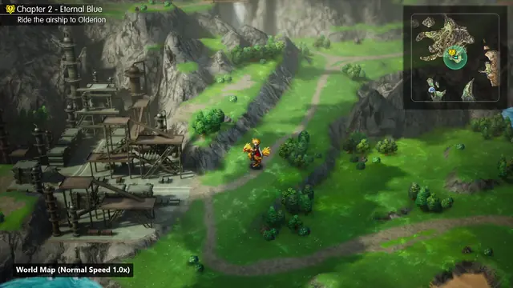
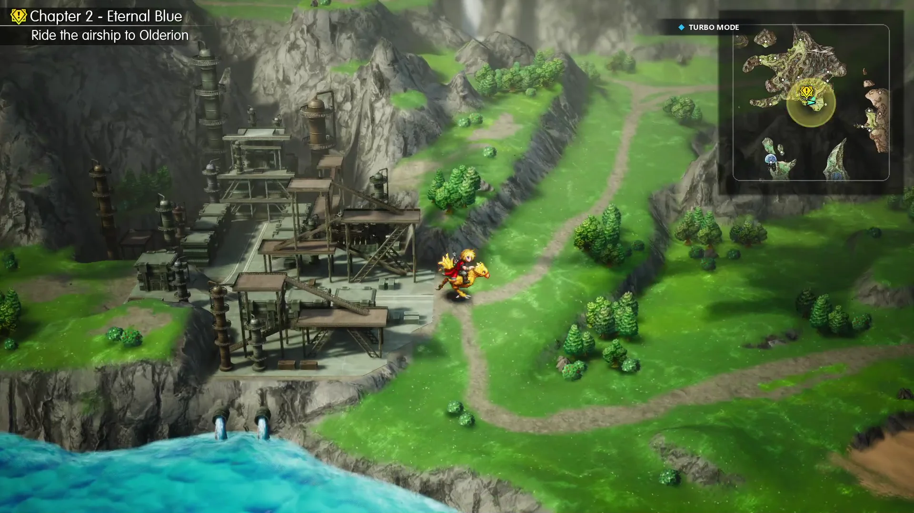
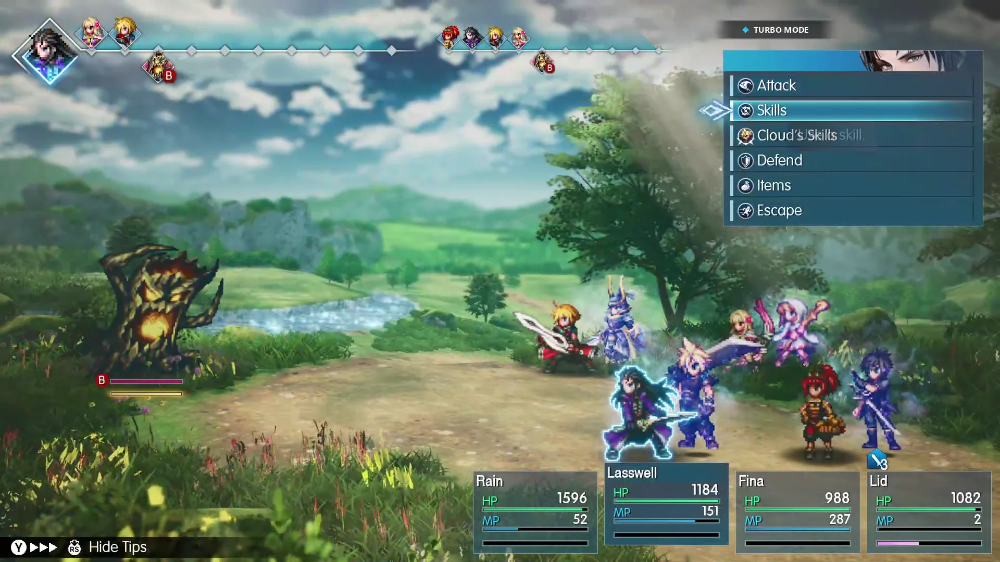

# Final Fantasy Resonance Turbo

[](https://github.com/DarRahman/Final-Fantasy-Resonance-Turbo/releases)
[](#installation)
[](LICENSE)

A lightweight, standalone High-Speed Turbo mod for **FINAL FANTASY RESONANCE** on PC.

## What Does This Mod Do?

This mod adds a standalone **Turbo Mode** to *FINAL FANTASY RESONANCE* on PC, letting you speed up the entire game to **2.5x** (or any custom speed) with a single button press.

While many modern JRPGs now include a fast-forward feature, this mod's pacing and seamless integration are heavily inspired by the excellent High-Speed Mode seen in Nihon Falcom's *Trails in the Sky FC* (2025) and *Trails in the Sky SC* (2026) remakes.

Unlike standard in-game options that only increase battle speed, this mod accelerates the engine's internal tick rate so everything runs faster together in sync:
- Overworld and dungeon movement.
- Turn-based combat and enemy turns.
- Dialogue text and cutscenes.

You can toggle it on or off anytime with a single tap of **RT** on your controller or **F1** on keyboard.

---

## Preview

<!-- Animated WebP showing the Turbo toggle in action -->


*Full 1080p 60 FPS video showcase available in [`assets/Final_Showcase_Demo.mp4`](assets/Final_Showcase_Demo.mp4).*

<table>
  <tr>
    <th width="50%">Field Exploration</th>
    <th width="50%">Turn-Based Combat</th>
  </tr>
  <tr>
    <td></td>
    <td></td>
  </tr>
</table>

---

## How to Use

- **Xbox Controller**: Tap **RT (Right Trigger)** to toggle Turbo on or off.
- **Keyboard**: Press **F1** to toggle Turbo on or off.
- When active, a clean `◆ TURBO MODE` badge appears in the top bar. Tap the button again to return to normal 1.0x speed, and the badge vanishes.

---

## Installation

1. Download `Final-Fantasy-Resonance-Turbo.zip` from [Releases](https://github.com/DarRahman/Final-Fantasy-Resonance-Turbo/releases).
2. In Steam, right-click **FINAL FANTASY RESONANCE** → **Manage** → **Browse local files**.
3. Open the binary folder (where `FFRS-Win64-Shipping.exe` is located):
   ```text
   FINAL FANTASY RESONANCE\FFRS\Binaries\Win64\
   ```
4. Extract the zip files directly into that folder:
   - `dwmapi.dll`
   - `turbo_config.ini`
   - `assets/` (contains `indicator.png`)
5. Launch the game through Steam.

*Note: This mod modifies 0 bytes of original game files on disk. To uninstall, simply delete `dwmapi.dll`, `turbo_config.ini`, and `assets/` from that folder.*

### Using alongside UE4SS?
If you have UE4SS installed (for mods like Fast Travel or Auto-Battle):
1. In `FFRS\Binaries\Win64\`, rename UE4SS's original `dwmapi.dll` to: `dwmapi_ue4ss.dll`
2. Extract this mod's files into that same folder.

FFRS Turbo will automatically detect `dwmapi_ue4ss.dll` on game launch and load both mods together.

### Steam Deck & Linux (Proton)
Add this to the game's **Launch Options** in Steam:
```bash
WINEDLLOVERRIDES="dwmapi=n,b" %command%
```

---

## Configuration (`turbo_config.ini`)

All settings can be customized without recompiling. Open `turbo_config.ini` in any text editor:

- **`SpeedMultiplier`** (Default: `2.5`): Game speed multiplier when Turbo is active (e.g. `2.0`, `3.0`, `4.0`).
- **`GamepadButton`** (Default: `RIGHT_TRIGGER`): Controller toggle button.
- **`KeyboardKey`** (Default: `0x70`): Keyboard toggle key in Windows virtual key hex code.
- **`DebounceMs`** (Default: `250`): Minimum delay between button presses in milliseconds to prevent accidental double-toggling.

---

## Gameplay Notes & Limitations

- **3D Video Cutscenes**: Pre-rendered cinematics (such as special Vision attacks) stream audio on real-time hardware clocks. Because Turbo accelerates the game engine timeline, the video may finish playing before its audio track completes. If you want to watch a cinematic cutscene normally, tap **RT** to pause Turbo, or use the controller's **View / Back** button to skip the animation.
- **In-Game Battle Speed**: Keep the game's built-in battle speed set to **1x**. Turbo Mode will speed up the entire battle smoothly at 2.5x.
- **File Safety**: This mod does not touch or modify any original game files.

---

## Contributing

Contributions, bug reports, and suggestions are welcome! Feel free to open an issue or submit a pull request.

---

## Author

[@DarRahman](https://github.com/DarRahman)

---

## Note

This mod was developed with AI assistance and thoroughly tested, audited, and verified in-game on PC by [@DarRahman](https://github.com/DarRahman).

---

## Credits

- [MinHook](https://github.com/TsudaKageyu/minhook) by Tsuda Kageyu — The minimal x86/x64 API hooking library for Windows.

---

## License

Released under the [MIT License](LICENSE).
